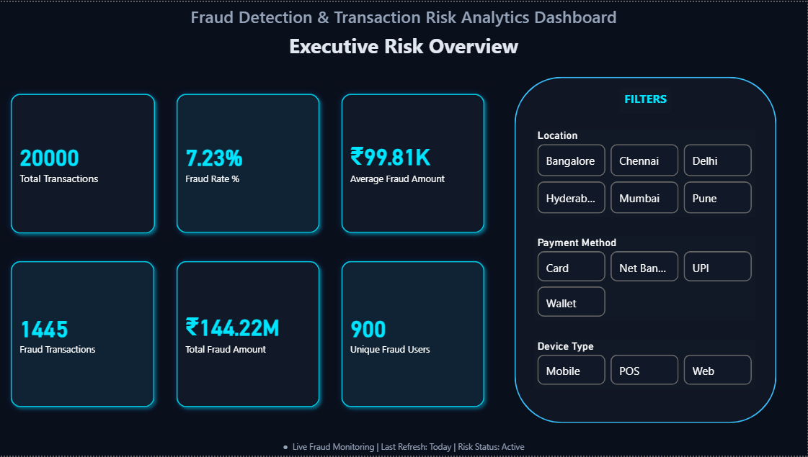
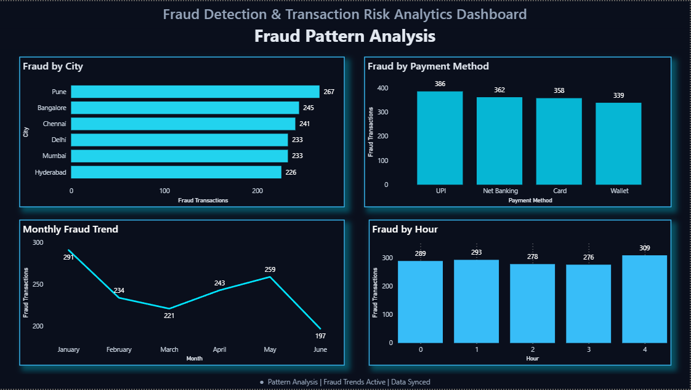

<div align="center">

#  Fraud Detection & Transaction Risk Analytics Dashboard

**An end-to-end Business Intelligence project using SQL and Power BI to detect fraud patterns, monitor transaction risk, and support data-driven decisions.**


</div>

---

##  Table of Contents

- [Project Overview](#-project-overview)
- [Business Problem](#-business-problem)
- [Objectives](#-objectives)
- [Dataset](#-dataset)
- [Tools & Technologies](#-tools--technologies)
- [Project Workflow](#-project-workflow)
- [Dashboard Pages & KPIs](#-dashboard-pages--kpis)
- [SQL Analysis Highlights](#-sql-analysis-highlights)
- [Key Insights](#-key-insights)
- [Dashboard Preview](#-dashboard-preview)
- [Repository Structure](#-repository-structure)
- [How to Use This Project](#-how-to-use-this-project)
- [Limitations & Future Scope](#-limitations--future-scope)
- [Conclusion](#-conclusion)
- [Author](#-author)

---

##  Project Overview

This project analyzes financial transaction data to identify fraudulent activity and monitor transaction risk. Raw transaction records are processed and analyzed with **SQL (PostgreSQL)**, and the results are presented in an interactive **Power BI** dashboard.

The dashboard allows stakeholders to explore fraud trends, locate hotspots, compare payment methods and devices, classify transactions by risk level, and identify high-risk users.

---

##  Business Problem

Financial institutions process thousands of transactions every day, which makes manual fraud detection impractical. Delayed detection can lead to significant financial loss and operational risk.

This project addresses that challenge by:

- Identifying suspicious patterns in transaction data
- Tracking fraud-related KPIs in one place
- Giving business users an interactive tool to detect fraud trends quickly

---

##  Objectives

- Analyze financial transaction data using SQL
- Monitor fraud KPIs through interactive dashboards
- Identify fraud hotspots by transaction location
- Compare fraud across payment methods
- Analyze fraud distribution by device type
- Study fraud trends over time (monthly and hourly)
- Categorize transactions into risk levels
- Identify high-risk users involved in fraudulent transactions
- Build a user-friendly, filterable dashboard for business users

---

##  Dataset

> **Note:** The dataset is **simulated** and was generated programmatically with Python for learning and portfolio purposes. It does not contain real customer or financial data.

To mimic a real-world fraud scenario, randomized transaction records were created with realistic attributes. Additional fields (risk level, transaction hour, amount category) were derived to support advanced SQL analysis and Power BI visualizations.

**Total records:** 20,000+

| Field | Description |
|:--|:--|
| `Transaction ID` | Unique identifier for each transaction |
| `User ID` | Unique identifier for each user |
| `Transaction Amount` | Value of the transaction |
| `Transaction Date & Time` | Timestamp of the transaction |
| `Merchant Category` | Category of the merchant |
| `Transaction Location` | City where the transaction occurred |
| `Device Type` | Device used (e.g., mobile, desktop) |
| `Payment Method` | Method used (e.g., UPI, card) |
| `Failed Login Attempts` | Number of failed logins before the transaction |
| `Fraud Status` | Whether the transaction was fraudulent |
| `Transaction Hour` | *(Derived)* Hour of day of the transaction |
| `Risk Level` | *(Derived)* Risk category of the transaction |
| `Amount Category` | *(Derived)* Bucketed transaction amount |

---

##  Tools & Technologies

| Category | Tools |
|:--|:--|
| **Database & Analysis** | SQL (PostgreSQL) |
| **Visualization** | Power BI |
| **Data Generation & Preprocessing** | Python, Pandas, NumPy |
| **Version Control** | Git, GitHub |

---

##  Project Workflow

```text
Dataset Generation → Data Cleaning & Preprocessing → SQL Analysis
        → KPI Development → Power BI Dashboard Design → Business Insights
```

1. **Dataset Generation:** Create simulated transaction data using Python
2. **Data Cleaning & Preprocessing:** Validate data and derive new fields
3. **SQL Data Analysis:** Query and aggregate data in PostgreSQL
4. **KPI Development:** Define fraud and risk metrics
5. **Dashboard Design:** Build interactive reports in Power BI
6. **Insight Extraction:** Summarize findings for decision-making

---

##  Dashboard Pages & KPIs

### 1️⃣ Executive Risk Overview

- Total Transactions
- Fraud Transactions
- Fraud Rate (%)
- Average Fraud Amount
- Total Fraud Amount
- Unique Fraud Users
- Interactive filters: **Location, Payment Method, Device Type**

### 2️⃣ Fraud Pattern Analysis

- Fraud hotspots by city
- Fraud by payment method
- Monthly fraud trend
- Fraud by transaction hour

### 3️⃣ Risk Intelligence & User Behavior

- Risk level distribution
- Fraud by device type
- Transaction amount categories
- Top fraud users

---

##  SQL Analysis Highlights

<details>
<summary><b>Fraud rate by payment method</b></summary>

```sql
SELECT
    payment_method,
    COUNT(*)                                              AS total_transactions,
    SUM(CASE WHEN fraud_status = 1 THEN 1 ELSE 0 END)     AS fraud_transactions,
    ROUND(
        100.0 * SUM(CASE WHEN fraud_status = 1 THEN 1 ELSE 0 END) / COUNT(*), 2
    )                                                     AS fraud_rate_pct
FROM transactions
GROUP BY payment_method
ORDER BY fraud_rate_pct DESC;
```

</details>

<details>
<summary><b>Monthly fraud trend</b></summary>

```sql
SELECT
    DATE_TRUNC('month', transaction_datetime) AS month,
    COUNT(*)                                  AS fraud_transactions,
    SUM(transaction_amount)                   AS fraud_amount
FROM transactions
WHERE fraud_status = 1
GROUP BY 1
ORDER BY 1;
```

</details>

<details>
<summary><b>Top fraud users</b></summary>

```sql
SELECT
    user_id,
    COUNT(*)                AS fraud_transactions,
    SUM(transaction_amount) AS total_fraud_amount
FROM transactions
WHERE fraud_status = 1
GROUP BY user_id
ORDER BY total_fraud_amount DESC
LIMIT 10;
```

</details>

> The column and table names above are examples. Adjust them to match the scripts in the `sql/` folder.

---

##  Key Insights

-  Certain cities showed noticeably higher fraudulent transaction activity, highlighting geographic hotspots.
-  **UPI** transactions recorded the highest number of fraud cases among payment methods.
-  **Mobile devices** accounted for the largest share of fraudulent transactions.
-  Fraud activity varied significantly across different hours of the day.
-  High-risk transactions made up a small portion of total volume but represented significant financial exposure.
-  Interactive filters allow detailed drill-down by location, payment method, and device type.

<!-- Optional: add exact figures from your dashboard, e.g. overall fraud rate, top city, peak fraud hour. -->

---

##  Dashboard Preview

### Executive Risk Overview


### Fraud Pattern Analysis


### Risk Intelligence & User Behavior


---

##  Repository Structure

```text
fraud-detection-analytics/
│
├── datasets/      # Transaction dataset used for analysis
├── sql/           # SQL scripts for database creation and analysis
├── dashboard/     # Power BI dashboard file (.pbix)
├── images/        # Dashboard screenshots
└── README.md      # Project documentation
```

---

##  How to Use This Project

1. **Clone the repository**
```bash
   git clone https://github.com/Shivampraja9/YOUR_REPO_NAME.git
```
2. **Set up the database:** Create a PostgreSQL database and run the scripts in `sql/`.
3. **Load the data:** Import the dataset from `datasets/` into the database.
4. **Open the dashboard:** Open the `.pbix` file from `dashboard/` in Power BI Desktop.
5. **Refresh the data source:** Update the connection settings to point to your local database or dataset.

---

##  Limitations & Future Scope

**Limitations**
- The dataset is simulated, so the patterns reflect the generation logic rather than real-world fraud behavior.
- The project focuses on descriptive and diagnostic analytics, not predictive modeling.

**Future improvements**
- Build a machine learning model (e.g., logistic regression, random forest) to predict fraud probability
- Add anomaly detection for unusual transaction behavior
- Automate data refresh and reporting
- Test the approach on a real or publicly available fraud dataset

---

##  Conclusion

This project shows how SQL and Power BI can be combined to analyze financial transaction data and uncover fraud patterns. The interactive dashboard helps users monitor fraud metrics, assess transaction risk, and draw actionable insights that support better decision-making.

---

##  Author

**[Shivam]**
Data Analyst focused on SQL, Power BI, data cleaning, exploratory analysis, and business insights.


